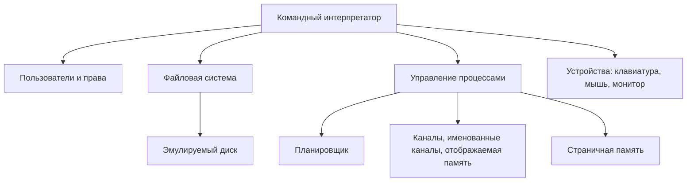

# QuantaOS

> Гипотетическая многопользовательская операционная система и эмулятор её ключевых модулей на Java: файловая система по образцу NTFS, планировщик процессов, межпроцессное взаимодействие, страничная память и командный интерпретатор.

Автор: Кирилл Куклин

**Статус:** 🚧 в разработке. Таблица ниже показывает, что уже сделано.

## Почему «Quanta»

И время, и память в ОС делятся на дискретные порции: процессору выдаётся *квант* времени, оперативная память режется на *страницы*, диск на *кластеры*. Название отражает эту идею.

## Возможности

| Модуль | Описание | Статус |
| --- | --- | --- |
| Файловая система | Реализация основных механизмов NTFS на Java: MFT, атрибуты, битовая карта кластеров, многоуровневые каталоги | ⬜ планируется |
| Пользователи и права | Вход/выход, группы, права доступа, многопользовательская защита | ⬜ планируется |
| Планировщик процессов | Квантование времени, абсолютные, относительные и динамические приоритеты | ⬜ планируется |
| Межпроцессное взаимодействие | Каналы, именованные каналы, отображаемая память | ⬜ планируется |
| Управление памятью | Страничная организация | ⬜ планируется |
| Устройства | Клавиатура, мышь, монитор (драйверы-эмуляторы) | ⬜ планируется |
| Командный интерпретатор | Интерактивная консоль для работы с ОС | ⬜ планируется |

## Режим работы ОС

Мультипрограммная, интерактивная, с многопользовательской защитой.

## Архитектура



## Файловая система (NTFS на Java)

Файловая система реализует ключевые идеи NTFS: всё хранится в виде записей MFT, а свободное место учитывается битовой картой кластеров. Формат собственный, без побайтовой совместимости с реальными томами Windows.

| Механизм NTFS | Реализация |
| --- | --- |
| Кластер как единица выделения | Фиксированный размер кластера на эмулируемом диске |
| `$Bitmap`: битовая карта кластеров | Битовая карта свободных/занятых кластеров |
| MFT: запись на каждый файл и каталог | Таблица записей MFT с атрибутами (имя, размер, владелец, права, метки времени, данные) |
| Каталог как файл с индексом | Многоуровневые каталоги со ссылками на записи MFT |
| Журналирование, сжатие, шифрование | Не входят в первую версию |

Файлы поддерживают последовательный доступ.

## Команды

| Группа | Команды |
| --- | --- |
| Сессия | вход в систему, выход из системы |
| Пользователи | создание пользовательских групп, изменение прав доступа |
| Файлы и каталоги | создание файла, создание каталога, копирование, перемещение, переименование, удаление, дописать в конец файла |
| Процессы | информация о процессорах, изменение приоритета процесса, уничтожение процесса |

Точный синтаксис команд будет добавлен по мере реализации.

## Технологии

- Java 21, Maven
- JLine 3 (консоль с историей команд)
- JUnit 5, AssertJ (тесты)
- SLF4J + Logback (журнал работы планировщика и ФС)

## Быстрый старт

Требования: JDK 21 и Maven.

```bash
git clone <ссылка-на-репозиторий>
cd quanta-os
mvn package
java -jar target/quanta-os.jar
```

> Сборка пока не настроена и появится вместе с первым рабочим модулем.

## Структура репозитория

```
quanta-os/
├── src/main/java/.../quanta/
│   ├── fs/        файловая система
│   ├── auth/      пользователи, группы, права
│   ├── sched/     планировщик
│   ├── ipc/       межпроцессное взаимодействие
│   ├── mem/       страничная память
│   ├── dev/       устройства
│   └── shell/     командный интерпретатор
├── src/test/java/
├── docs/          документация и схемы
└── README.md
```

## Тесты

```bash
mvn test
```

## Дорожная карта

1. Файловая система: диск, битовая карта, MFT, каталоги
2. Пользователи, группы, права доступа
3. Процессы и планировщик
4. Межпроцессное взаимодействие
5. Страничная память
6. Командный интерпретатор и устройства

## Вклад в проект

Коммиты оформляются по [Conventional Commits](https://www.conventionalcommits.org/): `feat(fs): ...`, `fix(shell): ...`, `docs: ...`, `test(sched): ...`.
