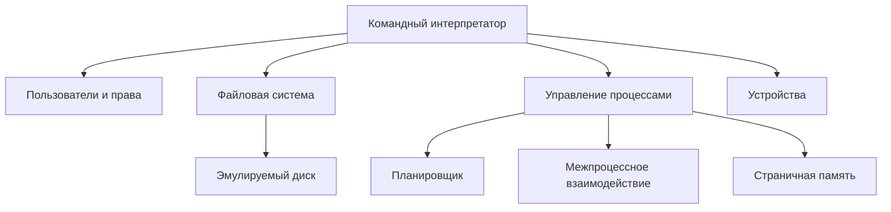

# QuantaOS

> Учебная многопользовательская операционная система на Java.  
> Первый реализованный модуль — файловая система, построенная по основным идеям NTFS.

Автор: Кирилл Куклин

**Статус:** 🚧 в разработке.

## Идея проекта

QuantaOS моделирует основные механизмы операционной системы:

- файловую систему;
- пользователей, группы и права доступа;
- планирование процессов;
- межпроцессное взаимодействие;
- страничную память;
- командный интерпретатор;
- устройства ввода и вывода.

Название «Quanta» отражает дискретное распределение ресурсов ОС:

- процессору выделяется квант времени;
- память делится на страницы;
- диск делится на кластеры.

## Режим работы ОС

Операционная система является:

- мультипрограммной;
- интерактивной;
- многопользовательской;
- защищённой с помощью пользователей, групп и прав доступа.

## Реализованные модули

| Модуль | Возможности | Статус |
| --- | --- | --- |
| Файловая система | Superblock, MFT, bitmap, кластеры, экстенты, B-деревья каталогов | ✅ |
| Пользователи и права | Login/logout, пользователи, группы, права `rwx` | ✅ |
| Командный интерпретатор | Команды работы с томом, файлами, каталогами и правами | ✅ |
| Планировщик процессов | Квантование времени, абсолютные, относительные и динамические приоритеты | ⬜ |
| Межпроцессное взаимодействие | Каналы, именованные каналы, отображаемая память | ⬜ |
| Управление памятью | Страничная организация памяти | ⬜ |
| Устройства | Клавиатура, мышь, монитор | ⬜ |

## Архитектура



## Файловая система

В проекте реализована учебная файловая система, использующая ключевые идеи NTFS.

Она не является побайтово совместимой с Windows NTFS и не является драйвером ОС. Цель модуля — показать работу основных структур и алгоритмов файловой системы.

| Механизм | Реализация |
| --- | --- |
| Superblock | Хранит параметры тома: размер диска, кластера, MFT и bitmap |
| Кластеры | Минимальная единица выделения места на диске |
| Bitmap | Битовая карта занятых и свободных кластеров |
| MFT | Таблица записей файлов и каталогов |
| Атрибуты MFT | Имя, размер, владелец, группа, права, даты, данные |
| Резидентные данные | Маленький файл хранится непосредственно в записи MFT |
| Нерезидентные данные | Большой файл хранится в кластерах |
| Extents | Непрерывные диапазоны кластеров большого файла |
| Каталоги | Каталог хранит индекс «имя → номер записи MFT» |
| B-дерево | Используется для быстрого поиска файлов в каталоге |
| Многоуровневые каталоги | Каждый каталог знает родительскую запись MFT |
| Последовательный доступ | Данные добавляются только в конец файла |
| Права доступа | Девять битов `owner/group/other rwx` |

## Пользователи, группы и права

Каждый пользователь содержит:

- логин;
- SHA-256 хеш пароля;
- UID — идентификатор пользователя;
- GID — идентификатор основной группы;
- роль пользователя.

Пользователь состоит ровно в одной основной группе.

Права доступа задаются тремя восьмеричными цифрами:

```text
754
```

Расшифровка:

```text
7 — владелец: чтение, запись, выполнение
5 — группа: чтение, выполнение
4 — остальные: только чтение
```

Права проверяются перед чтением, записью, созданием и просмотром содержимого каталогов.

Администратор имеет полный доступ ко всем объектам.

## Команды

### Работа с образом файловой системы

```text
format <file> <bytes> <admin> <password>
mount <file>
unmount
info
```

### Работа с сеансом и пользователями

```text
login <login> <password>
logout
useradd <login> <password> <group>
groupadd <name>
```

### Работа с файлами и каталогами

```text
mkfile <path>
mkdir <path>
append <path> <text>
cat <path>
copy <path> <directory>
move <path> <directory>
rename <path> <new-name>
delete <path>
chmod <path> <xyz>
```

### Навигация

```text
ls [path]
cd <path>
pwd
help
exit
```

## Пример работы

Создание образа файловой системы:

```text
format demo.ntfs 67108864 admin secret
```

Вход администратора:

```text
login admin secret
```

Создание каталога и файла:

```text
mkdir docs
mkfile docs/readme.txt
append docs/readme.txt "Привет, QuantaOS"
cat docs/readme.txt
```

Создание пользователя и группы:

```text
groupadd students
useradd alice password students
```

Изменение прав доступа:

```text
chmod docs/readme.txt 640
```

Просмотр параметров тома:

```text
info
```

Завершение работы с образом:

```text
unmount
```

## Технологии

- Java 21;
- Maven;
- Lombok;
- JUnit 5.

## Сборка и запуск

Требования:

- JDK 21;
- Maven.

Запуск тестов:

```bash
mvn test
```

Сборка проекта:

```bash
mvn package
```

Запуск приложения:

```bash
java -jar target/quanta-os-1.0.0.jar
```

> Имя JAR-файла зависит от `artifactId` и `version` в `pom.xml`.

## Структура проекта

```text
quanta-os/
├── pom.xml
├── README.md
├── src/
│   ├── main/
│   │   └── java/
│   │       └── org/
│   │           └── quantaos/
│   │               ├── Main.java
│   │               └── ntfs/
│   │                   ├── model/
│   │                   │   ├── Superblock.java
│   │                   │   ├── FileSystemState.java
│   │                   │   ├── MftEntry.java
│   │                   │   ├── Extent.java
│   │                   │   ├── BTree.java
│   │                   │   ├── User.java
│   │                   │   ├── Group.java
│   │                   │   └── Role.java
│   │                   └── service/
│   │                       ├── NtfsVolume.java
│   │                       ├── VolumeStore.java
│   │                       ├── CommandShell.java
│   │                       ├── Access.java
│   │                       └── PasswordHasher.java
│   └── test/
│       └── java/
│           └── org/
│               └── quantaos/
│                   └── ntfs/
│                       └── NtfsVolumeTest.java
└── docs/
```

## Тестирование

Автоматические тесты проверяют:

- создание и монтирование образа;
- запись и чтение данных;
- переход малого файла в кластерное хранение;
- работу многоуровневых каталогов;
- поиск в B-дереве;
- сохранение данных после размонтирования;
- права доступа;
- рекурсивное удаление каталогов.

Запуск:

```bash
mvn test
```

## Дорожная карта

1. ✅ Файловая система: Superblock, MFT, bitmap, кластеры, экстенты.
2. ✅ Многоуровневые каталоги и B-деревья.
3. ✅ Пользователи, группы и права доступа.
4. ⬜ Планировщик процессов.
5. ⬜ Межпроцессное взаимодействие.
6. ⬜ Страничная память.
7. ⬜ Устройства.
8. ⬜ Расширение командного интерпретатора.

## Коммиты

В проекте используется Conventional Commits.

Примеры:

```text
feat(fs): implement NTFS-like filesystem core
feat(auth): add users groups and rwx permissions
test(fs): add volume persistence tests
fix(fs): validate access rights before file read
docs: update project README
```
