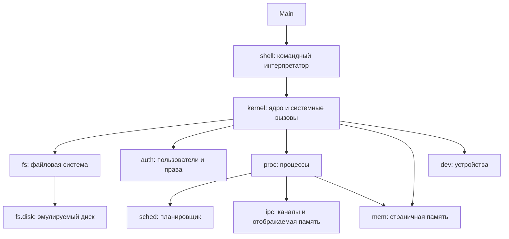

# Архитектура QuantaOS

## Слои

## Правила зависимостей

1. `shell` обращается только к `kernel`. Подсистемы напрямую он не вызывает.
2. `kernel` собирает подсистемы и даёт единый набор системных вызовов.
3. Подсистемы (`fs`, `auth`, `proc`, `sched`, `ipc`, `mem`, `dev`) не знают про `shell` и `kernel`.
4. Низкоуровневые пакеты (`fs.disk`, `fs.bitmap`) ничего не знают о верхних (`fs.mft`, `fs.dir`).
5. Общие исключения живут в `common`.

## Состав файловой системы

| Пакет | Ответственность | Аналог в NTFS |
| --- | --- | --- |
| `fs.disk` | Эмулируемый диск из кластеров | Том, кластер |
| `fs.bitmap` | Учёт свободных кластеров | `$Bitmap` |
| `fs.mft` | Записи файлов и каталогов, атрибуты | MFT, атрибуты |
| `fs.dir` | Иерархия каталогов, пути | Индексы каталогов |

## Порядок реализации

1. `fs.disk` и `fs.bitmap`
2. `fs.mft` и `fs.dir`
3. `auth`
4. `proc` и `sched`
5. `ipc`, `mem`
6. `shell`, `dev`, `kernel`
